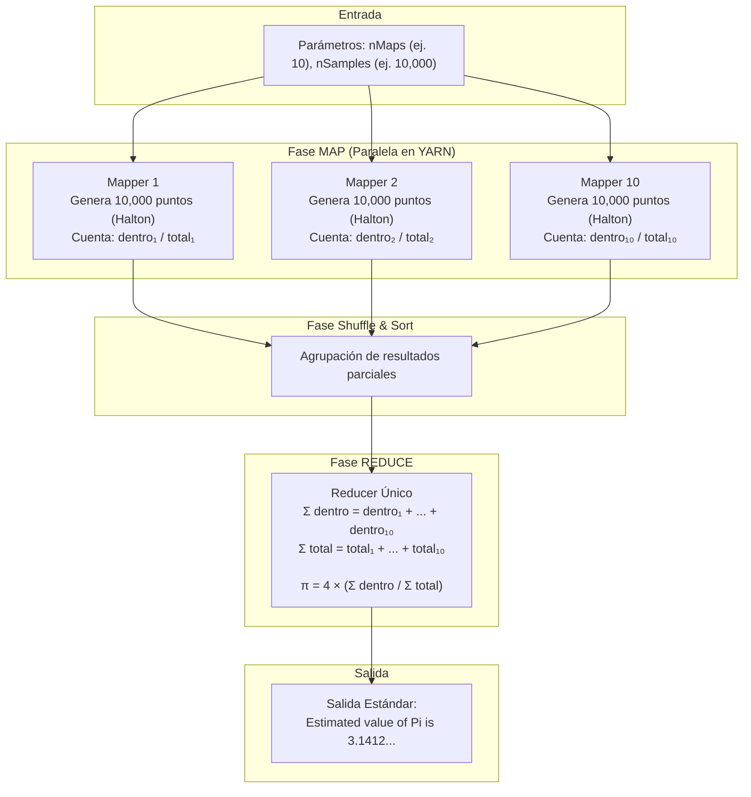

# 🎯 Estimación del Número Pi ($\pi$) mediante el Método de Monte Carlo en Hadoop MapReduce

[](https://hadoop.apache.org/)
[](https://www.docker.com/)
[](#)
[](#)

---

## 👥 1. Integrantes del Equipo
* **Integrante 1:** [Cuellar Ponce Angel Fernando]
* **Integrante 2:** [Aguilera Chavez Josue ]
* **Integrante 3:** [Jacobo Galindo Saul]

---

## 📖 2. Descripción del Ejemplo y Casos de Uso Real

### ¿Qué hace el ejemplo `pi`?
El ejemplo `pi` calcula una aproximación del número irracional $\pi$ utilizando el **Método de Quasi-Monte Carlo**.

En lugar de calcular $\pi$ mediante series analíticas infinitas, este método utiliza un enfoque probabilístico/geométrico:
1. Considera un cuadrado unitario de lado $1 \times 1$ con área $= 1$.
2. Inscribe dentro de él un cuarto de círculo de radio $r = 1$ con área $= \frac{\pi r^2}{4} = \frac{\pi}{4}$.
3. Genera miles o millones de puntos aleatorios $(x, y)$ uniformemente distribuidos en el cuadrado $[0, 1] \times [0, 1]$.
4. Evalúa cuántos puntos caen dentro del cuarto de círculo mediante el teorema de Pitágoras:
   $$x^2 + y^2 \le 1$$
5. La relación entre los puntos interiores y el total de puntos converge a la relación de sus áreas:
   $$\frac{\text{Puntos adentro}}{\text{Total de puntos}} \approx \frac{\text{Área del cuarto de círculo}}{\text{Área del cuadrado}} = \frac{\pi}{4}$$
6. Despejando $\pi$:
   $$\pi \approx 4 \times \frac{\text{Puntos adentro}}{\text{Total de puntos}}$$

```
  Y ▲
1.0 ┼───────────────╮ (1, 1)
    │  •   •   •   /│
    │ •   •   •   / │  • = Puntos adentro (x² + y² ≤ 1)
    │•   •   •   /  │  x = Puntos afuera
    │ •   •  •  / x │
    │• •  • •  /  x │
    │ • • • • /  x  │
0.0 ┼────────┴──────┴──▶ X
   0.0             1.0
```

### Casos de Uso en el Mundo Real
El método de Monte Carlo en sistemas distribuidos es un estándar industrial cuando los problemas analíticos exactos son intratables:
* **Finanzas cuantitativas:** Simulación de carteras de inversión, cálculo del Valor en Riesgo (VaR) y fijación de precios de opciones financieras con miles de escenarios estocásticos concurrentes.
* **Física y Química Computacional:** Simulación de transporte de radiación y difusión de neutrones en reactores nucleares (donde originalmente nació el método en Los Álamos).
* **Bioinformática y Genómica:** Modelado del plegamiento de proteínas y simulaciones moleculares.
* **Cálculo de Integrales en Alta Dimensión:** Cuando las funciones tienen decenas o cientos de dimensiones y las cuadraturas numéricas tradicionales sufren la *maldición de la dimensionalidad*.

---

## ⚙️ 3. Requisitos Previos

1. Contenedor Docker de la práctica con **Hadoop 3.3.6** previamente instalado y funcionando (nombre del contenedor: `hadoop`).
2. Docker Desktop o Docker Engine encendido en tu máquina anfitriona.
3. Terminal con Git instalado para clonar este repositorio.

---

## 🧩 4. Explicación de las Fases Map y Reduce

El cálculo de Pi es un problema **vergonzosamente paralelo** (*embarrassingly parallel*): cada punto generado es totalmente independiente de los demás, por lo que no se requiere comunicación entre mappers durante el cómputo.

### Diagrama de Flujo del Job MapReduce



### ¿Qué entra y qué sale en cada fase?

1. **Fase MAP:**
   * **Entrada:** Un split virtual que indica el offset o segmento de la secuencia de Halton y la cantidad de muestras a generar (`nSamples`).
   * **Procesamiento:** Cada Map genera $N$ puntos $(x_i, y_i)$ y evalúa si $x_i^2 + y_i^2 \le 1$.
   * **Emite:** Pares clave-valor intermedios con el recuento local:
     * `("inside", num_puntos_adentro)`
     * `("total", nSamples)`

2. **Fase REDUCE:**
   * **Entrada:** La lista consolidada de recuentos de todos los mappers.
   * **Procesamiento:** Acumula la suma total de puntos dentro de la circunferencia y la suma total de puntos evaluados.
   * **Emite:** El cociente multiplicado por 4:
     $$\pi = 4 \times \frac{\sum \text{dentro}}{\sum \text{total}}$$
     E imprime en la consola el valor estimado y el tiempo transcurrido.

---

## 🚀 5. Paso a Paso para Reproducir la Práctica

Sigue estos comandos en orden exacto. Presta atención al ícono al inicio de cada bloque:
* 💻 = Comando a ejecutar en la terminal de **tu computadora**.
* 🐳 = Comando a ejecutar en la terminal **dentro del contenedor Hadoop**.

---

### Paso 1: Iniciar y entrar al contenedor

Verifica si tu contenedor existe y está activo:
```bash
# 💻 En tu computadora:
docker ps -a
```

Si el contenedor `hadoop` está apagado (*Exited*), enciéndelo e ingresa con:
```bash
# 💻 En tu computadora:
docker start -ai hadoop
```
*(Si ya estaba encendido en segundo plano, puedes entrar directamente con: `docker exec -it hadoop bash`).*

Si entraste como el usuario `root`, cámbiate inmediatamente al usuario `hadoop`:
```bash
# 🐳 Dentro del contenedor:
su - hadoop
```

---

### Paso 2: Verificar que los servicios de Hadoop estén activos

Comprueba que el sistema distribuido HDFS y YARN estén corriendo:
```bash
# 🐳 Dentro del contenedor:
jps
```

**Resultado esperado del comando `jps`:**
Debes ver los siguientes demonios activos:
* `NameNode`
* `DataNode`
* `ResourceManager`
* `NodeManager`
* `SecondaryNameNode`

*(Si alguno falta, inícialos con `start-dfs.sh` y `start-yarn.sh`).*

---

### Paso 3: Clonar o copiar los scripts al contenedor

Puedes clonar este repositorio en tu computadora:
```bash
# 💻 En tu computadora:
git clone https://github.com/USUARIO/bda-equipo-4-pi.git
cd bda-equipo-4-pi
```

Copia la carpeta de scripts al contenedor:
```bash
# 💻 En tu computadora:
docker cp scripts/. hadoop:/home/hadoop/scripts/
```

Asigna permisos al usuario `hadoop` en el contenedor:
```bash
# 💻 En tu computadora:
docker exec -u root hadoop chown -R hadoop:hadoop /home/hadoop/scripts
```

---

### Paso 4: Ejecutar el ejemplo de Pi

Tienes dos formas de ejecutarlo:

#### Opción A: Usando el script automatizado
```bash
# 🐳 Dentro del contenedor:
chmod +x /home/hadoop/scripts/ejecutar.sh
/home/hadoop/scripts/ejecutar.sh 10 10000
```

#### Opción B: Ejecutando el comando nativo de Hadoop directamente
```bash
# 🐳 Dentro del contenedor:
hadoop jar $HADOOP_HOME/share/hadoop/mapreduce/hadoop-mapreduce-examples-3.3.6.jar pi 10 10000
```
> **Explicación de los parámetros:**
> * `10`: Número de mapas (tareas paralelas).
> * `10000`: Muestras generadas por cada mapa ($10 \times 10,000 = 100,000$ puntos en total).

---

### Paso 5: Copiar los resultados a tu computadora

Para respaldar la salida en tu repositorio local:
```bash
# 🐳 Dentro del contenedor (guardar salida a un archivo):
hadoop jar $HADOOP_HOME/share/hadoop/mapreduce/hadoop-mapreduce-examples-3.3.6.jar pi 10 10000 > /tmp/salida_pi.txt 2>&1
```

```bash
# 💻 En tu computadora:
docker cp hadoop:/tmp/salida_pi.txt resultados/salida_consola.txt
```

---

## 🎯 6. Resultado Esperado

Al concluir el trabajo de MapReduce, la terminal mostrará un resumen del Job junto con el valor calculado de Pi:

```text
Job Finished in 32.54 seconds
Estimated value of Pi is 3.14120000000000000000
```

* **Valor estimado:** `3.14120000000000000000`
* **Valor matemático real:** `3.14159265358979323846...`
* **Error relativo:** Apenas $\approx 0.0125\%$, lo que demuestra una alta convergencia con 100,000 muestras.

Para ver el log detallado completo con los contadores de YARN y HDFS, consulta [resultados/salida_consola.txt](resultados/salida_consola.txt).

---

## ⚠️ 7. Errores Comunes y Solución

### Error 1: `Connection refused` al conectar con ResourceManager o NameNode
* **Causa:** Los servicios de Hadoop (HDFS / YARN) no se habían arrancado tras reiniciar el contenedor.
* **Solución:**
  ```bash
  # 🐳 Dentro del contenedor:
  start-dfs.sh
  start-yarn.sh
  jps
  ```

---

### Error 2: `Permission denied (publickey,gssapi-keyex...)` o problemas de permisos al correr scripts
* **Causa:** Los archivos fueron copiados al contenedor con `docker cp` bajo el usuario `root` y el usuario `hadoop` no tiene permisos de lectura o ejecución.
* **Solución:**
  ```bash
  # 💻 En tu computadora:
  docker exec -u root hadoop chown -R hadoop:hadoop /home/hadoop/scripts
  ```

---

### Error 3: El comando `hadoop jar ...` indica `No such file or directory` para el JAR
* **Causa:** La variable `$HADOOP_HOME` no está cargada en la sesión actual.
* **Solución:**
  Carga las variables de entorno o usa la ruta absoluta estándar:
  ```bash
  # 🐳 Dentro del contenedor:
  source /home/hadoop/.bashrc
  # O ejecutar directamente con la ruta completa:
  hadoop jar /opt/hadoop/share/hadoop/mapreduce/hadoop-mapreduce-examples-3.3.6.jar pi 10 10000
  ```

---

### Error 4: Job atascado en estado `ACCEPTED` y nunca pasa a `RUNNING`
* **Causa:** El contenedor Docker no tiene suficiente memoria RAM asignada para alojar los contenedores de los Mappers solicitados y el ApplicationMaster.
* **Solución:**
  Reduce el número de Maps a un valor menor, por ejemplo `2` o `4`:
  ```bash
  # 🐳 Dentro del contenedor:
  hadoop jar /opt/hadoop/share/hadoop/mapreduce/hadoop-mapreduce-examples-3.3.6.jar pi 2 5000
  ```
  O aumenta la memoria asignada a Docker Desktop en `Settings -> Resources -> Memory`.

---

## 📂 8. Estructura del Repositorio

```text
bda-equipo-4-pi/
├── README.md                 <- Guía principal paso a paso
├── .gitignore                <- Reglas de exclusión para Git
├── datos/
│   ├── README.md             <- Explicación sobre la generación de datos in-memory
│   └── simular_montecarlo.py <- Script local didáctico de simulación
├── scripts/
│   └── ejecutar.sh           <- Script bash con verificación y medición de tiempos
├── resultados/
│   ├── README.md             <- Análisis de métricas y precisión
│   └── salida_consola.txt    <- Evidencia completa del log de ejecución
├── ejercicio/
│   ├── ejercicio.md          <- Mini ejercicio para los compañeros del grupo
│   └── solucion.md           <- Solución detallada y justificaciones
└── presentacion/
    └── guia_diapositivas.md  <- Guion y contenido para generar presentacion.pdf
```

